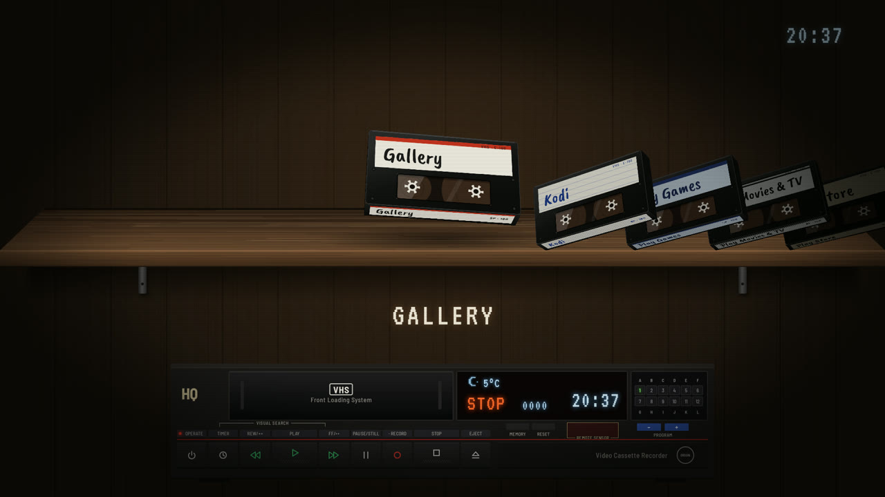
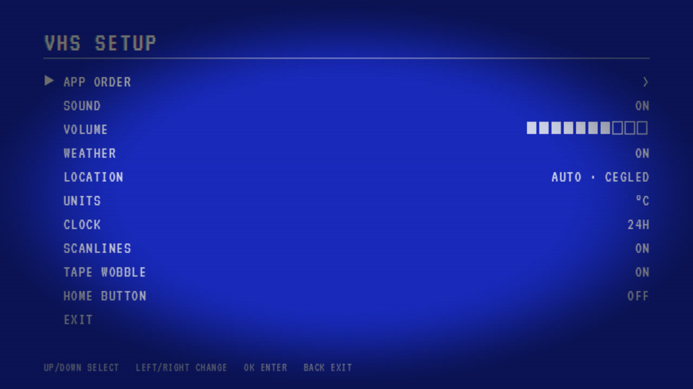

# VHS Launcher

[](https://kewuamigo.github.io/VHSLauncher/)
[](https://kewuamigo.github.io/VHSLauncher/vhs-launcher.apk)

[](https://github.com/kewuamigo/VHSLauncher/actions/workflows/pages.yml)


An Android TV home screen where every app is a VHS cassette on a shelf. Picking one loads it
into an Orion GHV-1223 P video recorder, then the app starts.

**[▶ Try the live demo](https://kewuamigo.github.io/VHSLauncher/)** — arrow keys to choose a
tape, Enter to load it, Esc to eject. No TV needed.

[](https://kewuamigo.github.io/VHSLauncher/)

*On a Google TV Streamer (Google TV 14), the TV it was built and tested on.*

| Setup tape menu | |
| --- | --- |
|  | App order, sound, weather, clock and effects, in the style of a late-80s VCR on-screen menu. |

Native Kotlin, no AndroidX or other libraries. The whole scene is a single OpenGL ES 2.0
surface: cassettes are real 3D boxes, flat artwork is painted once with Canvas into textures,
and the VHS snow and CRT scanlines are shaders.

## Browser preview

The live demo is published at **https://kewuamigo.github.io/VHSLauncher/**.

`web/` is the same launcher for the browser, for trying it without a TV: the scene runs on
WebGL, and apps open in a frame. It has no build step; to run it locally, serve the folder:

```bash
python -m http.server 8000 --directory web
```

Arrow keys, Enter and Esc work like the remote; the mouse wheel and clicks work too. The shelf
comes from `web/apps.json`. Only pages that allow being framed work there: use a site's embed
URL (YouTube `.../embed/<id>`, OpenStreetMap `export/embed.html`), since most home pages
refuse to load in a frame. A small back button in the corner (or Esc) returns to the shelf;
it exists only in the preview, where there is no remote.

### GitHub Pages

`.github/workflows/pages.yml` publishes `web/` on every push to `main`, and builds the APK
into the site as `vhs-launcher.apk`. Turn it on once in the repository: Settings › Pages ›
Build and deployment › Source: **GitHub Actions**.

The APK built there is signed with that runner's throwaway debug key, so an update from a later
build will not install over it; uninstall first, or add a real signing key as a secret.

## Build

Needs JDK 17 and the Android SDK (platform 35, build-tools 35.0.0). `local.properties` points
at the SDK.

```bash
./gradlew assembleRelease
```

The APK is `app/build/outputs/apk/release/app-release.apk`. It is signed with the debug key so
it installs as is; use your own key before publishing it anywhere.

## Install on a TV

Setting it up with an AI coding agent? Point it at [AGENT_INSTALL.md](AGENT_INSTALL.md): it walks
through installing, making VHS Launcher the default home on Android TV and Google TV (including
keeping the long-press Home panel), verifying, and rolling back.

Get the APK from the [download link](https://kewuamigo.github.io/VHSLauncher/vhs-launcher.apk)
(or build it, above), then:

```bash
adb connect <tv-ip>:5555
adb install -r vhs-launcher.apk
```

Press Home on the remote and choose VHS Launcher. On Google TV devices that do not offer a
choice, it also shows up as a normal app in the app list.

## Remote control

| Key | Action |
| --- | --- |
| Left / Right, Rewind / Fast forward | Previous / next cassette |
| Channel or Page up / down | Jump five cassettes |
| OK, Play | Load the cassette and start the app |
| Long-press OK, Menu | App info |
| Back, Stop, Eject | Cancel while loading |

Coming back to the launcher ejects the tape and puts it back on the shelf.

## Setup tape

The red SETUP cassette at the end of the shelf opens a blue VCR-style menu: app order
(pick up with OK, move with up/down, show/hide with left/right), sound and volume, weather
on/off, location (detected from the IP address, or a typed-in city), °C/°F, 12/24-hour clock,
scanlines, tape wobble, and the Home button service.

Weather comes from Open-Meteo and shows on the VCR display above STOP/PLAY. Without a city
set, the location is looked up from the IP address (ipwho.is, then ipapi.co).

## Home button on Google TV

Long-press Home opens a side panel that only the Google TV home app can show. To keep that
panel and still land in VHS Launcher, leave Google TV home enabled and turn on the
"VHS Home button" accessibility service (Settings › Accessibility, or over adb):

```bash
adb shell settings put secure enabled_accessibility_services hu.retro.vhslauncher/hu.retro.vhslauncher.HomeButtonService
adb shell settings put secure accessibility_enabled 1
```

It reacts only to the Home key: a short press opens VHS Launcher, holding it opens the panel.

After `adb install -r` of a new version, Android rebinds the service but it stops receiving the
Home key until it is switched off and on again:

```bash
adb shell settings put secure enabled_accessibility_services '""'
adb shell settings put secure enabled_accessibility_services hu.retro.vhslauncher/hu.retro.vhslauncher.HomeButtonService
```

## Sounds

`res/raw` holds clips cut from CC0 recordings on BigSoundBank; sources are listed in
`app/src/main/assets/SOUNDS.txt`.

## Permissions and network

- `INTERNET`, for the weather only. It talks to Open-Meteo (`api.open-meteo.com`, and
  `geocoding-api.open-meteo.com` when you type a city). With no city set, it also asks
  **ipwho.is**, then **ipapi.co**, where you are from your IP address, which sends that address to
  them. Set a city in SETUP › LOCATION, or turn WEATHER off, and those lookups stop.
- `BIND_ACCESSIBILITY_SERVICE`, for the optional **VHS Home button** service (Google TV only, off
  until you enable it). It filters the Home key and watches for the Google TV home window; it has
  `canRetrieveWindowContent="false"`, so it cannot read what is on screen.
- No analytics, no accounts, nothing else leaves the TV.

## Code map

- `MainActivity.kt`: window, remote keys, app launching, package-change updates
- `AppRepository.kt`: finds TV and phone apps, adds system Settings
- `SceneRenderer.kt`: the scene, the carousel and the insert/eject timeline
- `Art.kt`: Canvas painting of the room, the shelf, the VCR, cassettes and on-screen text
- `Gl.kt`: shaders, the quad and texture upload

Fonts (VT323, Caveat Brush, Barlow Semi Condensed) are under the SIL Open Font License; the
licence texts are next to them in `app/src/main/assets/fonts`.

## Licence

[MIT](LICENSE). The fonts (SIL Open Font License) and the sounds (see `SOUNDS.txt`) keep their own
licences.
